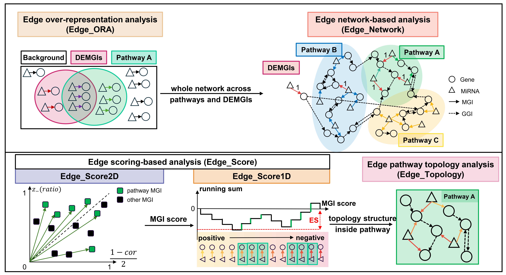

# miREA: a network-based tool for edge-based microRNA-oriented enrichment analysis

[](https://doi.org/10.64898/2026.02.27.708509)
[](https://zenodo.org/records/18803209)

We present miRNA-oriented Enrichment Analysis (**miREA**) framework, which
integrates miRNA-gene interaction (**MGI**) networks with miRNA and gene
transcriptomic data to improve functional interpretation of miRNAs.

miREA is designed to address the intrinsic many-to-many regulatory
interactions of MGIs and reduce biases introduced by conventional
node-centric enrichment approaches, by explicitly modeling **miRNA-gene
regulatory networks**, **pathway topology**, and **expression-informed MGI
edge scores**.



---

## Key Features

* miREA leverages **MGI** for network-based pathway enrichment analysis.
* miREA designs **MGI scores** to characterize regulatory strengths of MGIs.
* miREA implements **four node-based methods** and **five edge-based
  methods**, spanning over-representation, scoring-based, topology-aware, and
  network propagation approaches.
* The edge-based methods **outperform** node-based methods in sensitivity and
  biological interpretability.
* miREA elucidates **miRNA-gene-pathway regulatory mechanisms** in bladder
  cancer.

---

## Installation

```r
if (!requireNamespace("BiocManager", quietly = TRUE))
    install.packages("BiocManager")
BiocManager::install("miREA")
```

To install the development version directly from GitHub:

```r
if (!requireNamespace("BiocManager", quietly = TRUE))
    install.packages("BiocManager")
BiocManager::install("laixn/miREA")
```

## Usage

See `vignette("miREA")` for a full worked example using the small example
dataset bundled with the package (`?miREA_example_data`), covering the full
workflow: `getAllInputData()` → `miREA()` →
`plotSummary()`/`plotHeatmap()`/`plotHeatmapSankey()`.

```r
library(miREA)
vignette("miREA", package = "miREA")
```

Every exported function also has a runnable example on its own help page,
e.g. `?Edge_ORA`, `?Edge_Topology`.

## Output

miREA returns results containing:

* a list named `input_data` for the input data of miREA.
* a list named `result` for the enrichment result, including parameters,
  valid methods, time for different methods, and a data.frame for each
  method.
* visualization plots for methods comparison, and heatmap/Sankey plots for
  each edge-based method to explore the miRNA-gene-pathway regulatory
  mechanisms discovered.

All raw data, processed data, and original results for the various cancer
types and pathway sets used in the miREA manuscript have been deposited at
[](https://zenodo.org/records/18803209).

---

## Citation

Zhesi Zhang, Xin Lai. A network-based tool for microRNA-oriented enrichment
analysis. Submitted (2026).

```bibtex
@article{Zhang_miREA_2026,
  title={miREA: a network-based tool for microRNA-oriented enrichment analysis},
  author={Zhesi Zhang, Xin Lai},
  journal={bioRxiv},
  doi={10.64898/2026.02.27.708509},
  year={2026}}
```

---

© [Lai Lab](https://sites.google.com/view/lai-lab) - This package is
available under the [Artistic-2.0](https://opensource.org/licenses/Artistic-2.0)
license.
